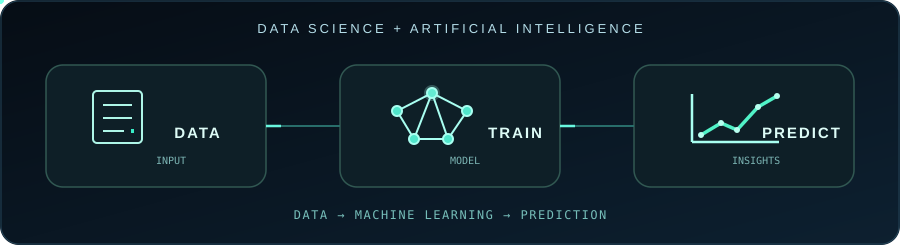

  

## 👨‍💻 About Me

- 🎓 Data Science Undergraduate at **SLTC Research University**
- ☁️ Exploring Cloud Engineering and DevOps
- 💻 Interested in Software Development
- 🌱 Building projects and learning new technologies

## 🛠️ Technologies

## 🚀 Featured Projects

<table>
  <tr>
    <td width="33%" valign="top">
      <h3 align="center">🧠 <a href="https://github.com/Deshan-003/DSA">DSA</a></h3>
      

        
        
      

      
A Java console-based suite for learning data structures and algorithm performance.

      
<strong>Highlights:</strong> Smart-city route planning, sorting comparisons, and timed searching benchmarks.

      
<a href="https://github.com/Deshan-003/DSA"><strong>View Project ↗</strong></a>

    </td>
    <td width="33%" valign="top">
      <h3 align="center">🎵 <a href="https://github.com/Deshan-003/yt-mp3">YT MP3</a></h3>
      

        
        
      

      
A Windows desktop app built with Electron, React, and TypeScript for saving permitted video audio as MP3.

      
<strong>Highlights:</strong> Local conversion, progress tracking, 320 kbps MP3 encoding, and a Windows installer.

      
<a href="https://github.com/Deshan-003/yt-mp3"><strong>Repository (Private) ↗</strong></a>

    </td>
    <td width="33%" valign="top">
      <h3 align="center">🛒 <a href="https://github.com/Deshan-003/minchi-store">Minchi Store</a></h3>
      

        
        
      

      
A responsive electronics storefront frontend built with Next.js, React, TypeScript, and Tailwind CSS.

      
<strong>Highlights:</strong> Product search and filtering, product details, cart, wishlist, and responsive UI.

      
<a href="https://github.com/Deshan-003/minchi-store"><strong>Repository (Private) ↗</strong></a>

    </td>
  </tr>
</table>

🔒 YT MP3 and Minchi Store are private repositories; their links require GitHub access. Minchi Store is a frontend preview, not a live shop.

## Github Activity

  

---

